# Spooky Stable v3 "Recess"

A no-menu, no-text toy firmware for the **M-VAVE FM-1**, made for a 3-year-old who loves crazy animation, bodily
humour and friendly spooky things. Eight buttons each open a toy starring the rainbow unicorn; every one of the 27
keys makes the toy act at once, with sound, shake, particles and a squash-and-stretch cartoon. Every note snaps to
the mood's scale, so nothing she plays can sound wrong.

**New in v3: School mode.** Ring the School Bell (hold OCT-) and four of the buttons open a learning toy instead:
a poop step sequencer, a two-unicorn FM synth, a pee pitch ladder and a booger wall. They teach rhythm, counting,
left-to-right order, pitch as height, consonance, memory and sorting, while still being the same silly toys. There
are no fail states, no text, no timers and no scores. Challenges are short invitations, and she can ignore every
one of them. Ring the Bell again for recess: Play mode is v2 exactly.

| | | |
|---|---|---|
| 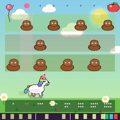 | 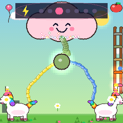 | 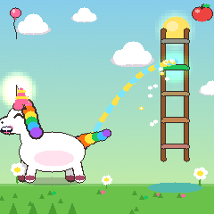 |
| 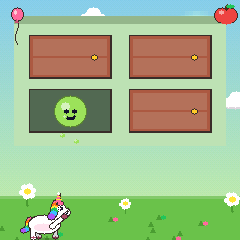 | 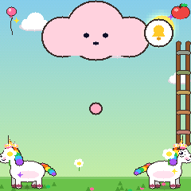 | 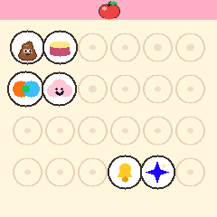 |

Play mode, as in v2:

| | | | |
|---|---|---|---|
| 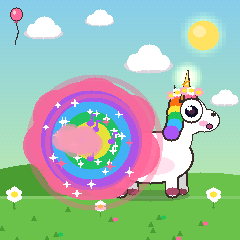 | 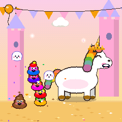 | 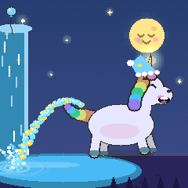 | 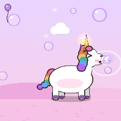 |
| 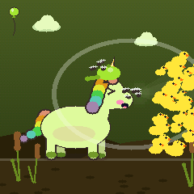 | 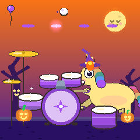 | 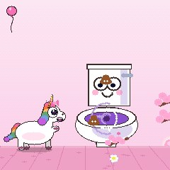 | 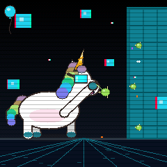 |

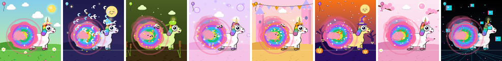

## The toys

| Button | Toy | Any key | K2 | K3 | K4 | K6 (ALGO) | K7 (PRESET) |
|---|---|---|---|---|---|---|---|
| **HOME** | Unicorn Fart | She braces, then a rainbow cloud bursts out (1 in 10 hides a winking skull); high keys squeak | duration 0.3–1.5 s | cloud size | pitch-bend depth | cloud style: rainbow / skull / glitter / slime | chaos: shake, particles, skulls |
| **EDIT** | Unicorn Poop | She strains and pops; a poop arcs onto the pile, each plop a step up the scale; every few the pile does a rainbow tower dance, every third a tiny ghost giggles away | drop rate while held, 1–12 a second | poop size | how far each plop climbs | classic / rainbow / glitter / slime | gravity and the pile's height before the dance |
| **LFO** | Unicorn Pee | Hold: a stream arcs into the pool while a flute sings; another key glides the flute there | pulse | arc height | glide range | sunny / rainbow / glitter / glow | splash chaos and puddle growth |
| **FX** | Unicorn Burp | A gulp, the belly swells, a held breath, then BURP with bubbles and an up-and-down rumble | duration | belly size | pitch | bubbles | echo and chaos |
| **ENV** | Unicorn Sneeze | Hold to breathe in (a bar rises at the left); let go: a silent beat, then CHOO, blowing everything in the cone off the screen | charge time 0.5–2 s | blast force | pitch | snot / rainbow / confetti / ducks | crunch, and a torn screen |
| **GLO** | Drum Jam | Left third drums, middle third cymbals, right third silly keys (boing, honk, slide whistle, "ow!") in the scale; all on a 16th-note grid | tempo 60–180 | swing 0–60 % | kit tuning | auto-drummer density | crunch and chaos |
| **ARP** | Toilet Flush | Something drops in and the toilet flushes: a whirlpool pulls in everything on the screen, each a bloop lower | flush speed | whirlpool size | gurgle pitch | poops / ducks / toilet rolls / rainbow fish | the water's colour and glow |
| **SEQ** | Booger Flick | Hold: hoof to nose, a glittery booger grows; let go: flick! It splats onto the wall (12 at most; the oldest slides off) | flick power | booger size | splat pitch | green / rainbow / glow / gold | how many the wall holds |

## School mode (v3)

| Control | What it does |
|---|---|
| **OCT-** held 0.7 s | **The School Bell.** A bright three-note bell in the mood's scale, and an apple pops into the top-right corner. If the toy on screen has a learning toy, it opens. Again: "recess!", a whoosh and confetti, back to Play mode and the play toy. A tap of OCT- is still the preset back. |
| A toy's own button held 1.5 s | Its learning toy, directly (School mode turns on). v2's 0.7 s cleanup sweep comes first. |
| OCT- held 2 s | **The Sticker Book**: 24 places for stickers, won by first discoveries and by "mastery moments" (three right in a row). The keys touch the stickers (four rows of six, left to right); each wiggles and sings. Any button closes it. Every fourth new sticker also brings the wardrobe's next hat or mane. |
| A learning toy's own button, tapped | Asks for a challenge (and she waves). |
| The first three long presses ever | A big ring of stars: how she finds out that holding does something. |
| **The parent's switch** | Within 5 s of power-on, hold OCT- and turn K1 up: every challenge is off (the learning toys stay, as toys). A sleepy apple says so; the same again turns them back on (a bright apple). It is remembered. |

While School mode is on, the apple stays in the corner (it wiggles while a challenge is open), OCT-'s light glows at
the middle level, and the keybed's dim layer rings like a bell, ding-ding... ding-ding, instead of breathing. School
mode, the stickers, each learning toy's difficulty and the Poop Parade's pattern are remembered across power cycles.

| Button in School mode | Learning toy | The keys | K2 | K3 | K4 | K6 (ALGO) | K7 (PRESET) |
|---|---|---|---|---|---|---|---|
| **EDIT** | **Poop Parade**: a step sequencer | Low third: the kick lane, its keys left to right the 8 columns; middle third: the snare lane; high third: the hat lane. A key: she runs to that column, squats, and a poop pops up into the lane (the same key flushes it). Key 24: Play/Stop (or PLAY): she marches left to right, stomping each column's poops flat as they play. Key 25: tap, the other page with 16 columns (else a nervous wobble); hold, flush everything. Key 26: Challenge | tempo 60–160 | swing 0–60 % | 8 or 16 columns | kit: acoustic / 808 / pots and pans / cartoon | chaos |
| **HOME** | **Fart Mix-Up**: a two-operator FM synth | Low half: the left unicorn's fart (the carrier), high half: the right one's (the modulator). Held: it sounds; ribbons rise, curve and merge in the mixer, and the merged one climbs to the cloud | left pitch | right pitch | ratio snap: free / 1:1 / 2:1 / 3:1 / 3:2 / 4:3 / 5:4 | mix ↔ mod | chaos (feedback, crunch, shimmer) |
| **LFO** | **Pee Piano**: a pitch ladder | Force, left to right: the arc's top hits a rung of the ladder, which lights and sings. Higher key, higher arc, higher note | stream power | arc spread | 3 / 5 / 7 rungs | tolerance | chaos |
| **SEQ** | **Booger Wall**: counting and memory | Match: a black key opens the top door above it, a white key the bottom one. Count and Sort: the keybed is 3–5 zones, left to right | fall speed (Sort) | booger size | the biggest wall | the game: Match / Count / Sort | chaos |
| FX, ENV, GLO, ARP | their play toys | as in Play mode, with the apple in the corner | | | | | |

K1 (volume) and K5 (the mood) are global, as in Play mode. OCT-/OCT+ pick the learning toy's sound: the plop, the right
unicorn's voice, the flute, or the boogers' voice.

**The challenges.** A challenge opens only after three free-play actions and a calm moment, never on a toy's first
visit, never twice without free play between, never while the Parade is marching. The Challenge key or a tap of the
toy's own button asks for one at any time. A three-note bell starts it, the unicorn shows what to do, then it is her
turn. A right step is a ding and sparkles. A wrong try is a soft downward boing and the right answer shown again:
never a buzzer, never red, and nothing is lost. If she is idle 8 s, the answer is shown again; if she plays
something else for 3 s, the challenge quietly ends. Each toy keeps one difficulty level, adjusted on its last 8
tries to aim at 70–80 % right.

| Toy | Challenges |
|---|---|
| Poop Parade | **Copy Me**: she poops a pattern with its sounds, it clears, you poop it back (3 poops in one lane with faint ghosts, then 3 anywhere, 4, 6). **Count Them**: she poops 1–3 (later 1–5); every press touches the next one, left to right, with a rising note and a dot. **Left to Right**: one poop on column 1, then 2, then 3...; it clears; go the same way (3, then 4 and 5). Her own parade is set aside for a challenge and comes back after the victory march. |
| Fart Mix-Up | **Make the Cloud Happy** (find a chord the cloud likes). **Copy the Interval**: an octave, then a fifth, then a fourth. **Count the Bumps** (later levels): turn K4 until the zigzag has 2 or 3 bumps, and play both. |
| Pee Piano | **Copy the Tune**: 3 rungs light in turn (growing to 5); pee them in the same order. A miss is a slide-whistle "womp" and the right rung lights again. **Fill the Bucket**: pee up to the line, then stop. Too much and she giggles as the bucket tips over, empty again. |
| Booger Wall | **Match**: each wall is a round; it grows from 2×2 to 3×2, 4×2 and 6×2. **Count**: some boogers land; press the zone with that many dots. A wrong zone makes them count themselves again, one note each. **Sort**: five boogers into the mouths of their colours; the wrong mouth spits it back up. |

## Everywhere

| Control | What it does |
|---|---|
| **K1** | Volume, shown as 10 dots. Never above 70 % of full scale (a soft-knee limiter at −6 dBFS, then the cap). Her pupils follow it. |
| **K5** (SELECT) | The mood: one of eight worlds. The sky, props, particles, the unicorn's hat and the musical scale change together, with a crossfade, a burst and a three-note sting. Sunny Meadow (major pentatonic), Moonlight (minor pentatonic), Swamp Stink (blues), Dreamy Float (whole tone), Sparkle Castle (lydian), Friendly Spooky (phrygian), Sakura (hirajoshi), Glitch (chromatic). |
| **OCT− / OCT+** | The toy's sound presets (4–5 each, very different instruments); an icon pops up and the keys light a pattern. Hold OCT+: back to the first. |
| **PLAY** | Auto-play: the toy plays itself, walking up and down the scale. In Drum Jam: the auto-drummer. |
| **REC** | Drum Jam: record four bars of her hits; they loop, lighting a strip of keys with a ghost hand; she plays over them. Hold REC: the loop is gone. Elsewhere: the last 10 seconds of her playing, played back. |
| **SEL** | The next unlocked hat; hold it for the next mane. A new hat or mane unlocks every 30 key presses and goes on at once. |
| **SAVE** | A surprise. Hold it for a second: quiet mode (20 % volume, a moon in the corner) for bedtime. |
| The toy's own button, held | Sweeps the screen clean (in the Toilet: the big flush). |
| Hold a key | In Fart, Burp, Drum Jam and the Toilet: a charge (a rising whine, the horn glowing, the keys filling up); let go when full for the MEGA version. |
| Mash | Five presses within 200 ms: MEGA, everything at once. |
| Chaos | The balloon in the corner blows up with fast playing: more particles and crunch; at half full a flourish, nearly full two backup dancers. |
| Idle | After 10 s she looks at you and waves, after 30 s she falls asleep and snores in time, after a minute she dreams of the toys. Any key wakes her with a start. |

Volume, quiet mode, the mood, each toy's preset and knobs, and the wardrobe are remembered across power cycles. A v2
unit's settings are carried over at the first v3 boot (School mode's new ones start empty).

## Get the .fwsc

The FM-1 package is built with JieLi's compiler, which is downloaded from JieLi's own server. Pick one way:

### A. On GitHub (nothing to install)

1. Unzip, then run `./setup.sh` once (it makes a git repository with fm1-base as the `base/` submodule, at the
   commit this was tested against).
2. Put your name and URLs in `app/fm1.toml` (the lines marked `# <- yours`), and commit.
3. Create an empty GitHub repository, then `git remote add origin ... && git push -u origin main`.
4. `git tag v3.0 && git push origin v3.0`. The workflow in `.github/workflows/release.yml` builds, tests and
   publishes a release with **`spooky-3.0.fwsc`**. (Or start it by hand from the Actions tab.)

### B. On your computer

Linux x86-64 natively; macOS with Docker running.

```sh
./setup.sh
python3 -m pip install pillow
sh base/tools/get_toolchain.sh                           # JieLi toolchain into ~/.jieli
export JIELI_TOOLCHAIN=~/.jieli/toolchain
git clone --depth 1 --branch AC79NN_SDK_V1.2.1_2023-12-13 \
    https://gitee.com/Jieli-Tech/fw-AC79_AIoT_SDK.git ~/fw-AC79_AIoT_SDK
export AC79_SDK=~/fw-AC79_AIoT_SDK
./build.sh                                               # -> app/build/spooky.fwsc
```

## Install

Back up anything you want to keep on the FM-1 first. Connect it by USB, then:

```sh
python3 -m pip install mido python-rtmidi
python3 base/tools/fm1_install.py app/build/spooky.fwsc
```

The bootloader is never touched, so the FM-1's safe mode and the way back to the stock firmware stay available.

## Test without an FM-1

```sh
./build.sh --host && sh tests/run_tests.sh
```

This runs the firmware in fm1-base's host simulator. v2's checks run unchanged, because Play mode must behave exactly
as v2: every toy, every knob, presets, moods, the loop recorder, replay, cleanup, quiet mode, idling, the wardrobe
and the settings across a power cycle (`app/tests/basic.txt`); every toy mashed at full volume against the 70 %
ceiling, the flash-rate limit and voice stealing (`app/tests/stress.txt`); and a 5-minute random soak. Then School
mode's checks (`app/tests/school.txt`): the Bell, the routing, direct entry, every learning toy's free play and all
eleven challenges, each answered wrong and then right, the pacing rules (first visit, calm moment, idle, busy),
adaptive difficulty, stickers and the book, the parent's switch, persistence, a v2 unit's settings migrated, and
the draw budgets. After that, every learning toy is mashed at full volume (`app/tests/stress_school.txt`), and a
5-minute soak runs with School mode's gestures in it. Screenshots land in `app/build/host/`. For the 30-minute
soaks: `python3 tests/make_soak.py 30 [--school] > app/build/soak.txt && app/build/host/spooky_host
app/build/soak.txt app/build/host`.

The challenges are random, so the scripts answer them with the app's own host-only command `answer` (or
`answer wrong`), which presses what the open challenge wants, in time, as a child would. `draws_reset` and
`expect draws` / `expect part_draws` measure shapes drawn per frame.

## The code

`app/app.c` is the app's own unity build: it includes the modules in order.

| File | What it is |
|---|---|
| `util.h` | random numbers, small maths, RGB565 colour, the universal colours |
| `draw.h/.c` | scanline primitives (ellipses, triangles, capsules, arcs, stars, hearts), the 16×16 additive glow sprite, the silhouette mode |
| `fx.h/.c` | easing library, trauma shake, hitstop, impact frames, the shared flash limiter, shockwave rings, the six transitions |
| `mood.h/.c` | the mood table, scales, `quantize_to_scale()`, the dithered sky column, the parallax props that blast, swirl and come home |
| `particles.h/.c` | the 200-particle pool (18-byte particles, 30 Hz ticks), 19 types |
| `patch.h/.c` | `patch_t`, every patch (the design's reference patches and their variants), Drum Jam's kits |
| `voice.h/.c` | the 12-voice synth, the FX bus, the limiter, and Drum Jam's sample-accurate sequencer |
| `unicorn.h/.c` | the one procedural unicorn rig and its accessories |
| `toys.h`, `knobs.h/.c`, `ui.h/.c` | the toy registry's types; the knobs and persistence; lights, chaos, charge, idle, overlays, replay |
| `toys/*.c` | one file per toy, and `common.c` (what they share) |
| `school.h/.c` | v3: the School Bell, routing, direct entry, the long-press discovery, the parent's switch, the apple, School mode's LEDs |
| `learn.h/.c` | v3: the challenge framework: pacing, the no-fail feedback, adaptive difficulty, a note scheduler, dot groups |
| `keymap.h/.c` | v3: physical key -> virtual grid, from plat.h's white and black key lists |
| `seq.h/.c` | v3: Poop Parade's 3 x 16 step sequencer, sample-accurate in the render (`steps_*`, apart from Drum Jam's `seq_*`) |
| `fm2.h/.c` | v3: Fart Mix-Up's live FM on v2's voices, and the cloud's consonance classifier |
| `ribbon.h/.c`, `ladder.h/.c` | v3: the wavy ribbon renderer and its paint-like colour mix; the pitch ladder |
| `stickers.h/.c` | v3: the 24 procedural stickers, the book, the new-sticker pop |
| `toys/poop_parade.c`, `fart_mixup.c`, `pee_piano.c`, `booger_wall.c` | v3: the four learning toys |

## v2: how it differs from the v2 design document

Choices made where the document and the FM-1 disagree, or where the document left room:

- **Base:** fm1-base and felucca-bsp (MPL-2.0), as v1, rather than a CoralFlower fork. The platform calls are v1's
  exactly; nothing in the platform is changed.
- **Knobs:** the FM-1's seven encoders are SELECT, ALGO, PRESET and K1–K4: K1–K4 are K1–K4, **K5 is SELECT**, K6 ALGO,
  K7 PRESET. The encoders have no push switch, so **quiet mode is a one-second hold of SAVE** instead of a long press
  of K1. The mood changes when the knob has rested 180 ms ("landing"), shown at once.
- **Extra buttons:** Toilet Flush is **ARP** and Booger Flick is **SEQ** (both free) rather than OCT− long-press or a
  key, so no key and no preset button loses its job. The wardrobe is **SEL** (tap: hat, hold: mane); SAVE taps are a
  surprise flourish, so no button is dead.
- **Key LEDs** are one colour on the FM-1 (off, dim, a middle level, lit), so "colour" became brightness and motion:
  a press lights its key and fades through the middle level with a ripple to its neighbours; a kick lights every
  key, a snare every other one, a hat runs one light along; a preset lights every Nth key; a mood change flashes them
  all; the idle keybed breathes (the dim layer's brightness, `plat_dim_ns`); auto-play is a chase.
- **Velocity** comes from the keys' own touch sensing (the FM-1 measures it), with a floor so soft hits are heard,
  rather than from the key's row. Drum Jam's "rows" are the keyboard's thirds, left to right.
- **Anticipation and the instant-response contract:** the sound starts on the press, and the hitstop and impact frame
  start with it (design 3.8); the frozen frames show the anticipation pose (braced, cheeks puffed), and the action
  bursts out with overshoot when the freeze ends. Sneeze's "three-frame anticipation freeze" comes after the
  release, as a silent held breath, then CHOO.
- **Mashing never freezes the toy:** a new hitstop waits 220 ms after the last; impact silhouettes are at most one
  per 340 ms; full-screen flashes and inverts share v1's limiter (one frame, at least 400 ms apart, under 3 Hz).
  The Glitch transition inverts one frame, not three (design 11 wins over 2.9).
- **The impact silhouette** is drawn in a light tint of the mood's accent: a white silhouette disappears on a white
  unicorn.
- **Fart patches** have the design's numbers plus a 17–26 Hz amplitude flutter and a little drive (what made v1's fart
  a fart), and their level is raised to v1's loudness. Every patch_t field not given in the document is marked in
  `patch.c`.
- **Drum Jam's grid:** a hit within the first 30 % of a 16th plays at once (it is on time), otherwise on the next
  16th; recording stores the step. The auto-drummer and the loop run in the audio render, sample-accurate.
- **Colours:** the mood table is the document's, plus a ground colour and two prop colours per mood derived from its
  gradient (the table has none). The things the v1 toys are made of (the rainbow mane, the poop's browns, the pee's
  yellow, the golden horn) are kept as fixed content colours; everything around them comes from the mood.
- **v1's ghost** survives only as the tiny giggling ghost of every third poop (behind `PROPS` in `toys/common.c`);
  the monster is gone. Neither is a destination.
- **The charge** works in Fart, Burp, Drum Jam (a fill) and the Toilet (the big flush). Poop, Pee, Sneeze and Booger
  use a held key for their own action (the machine gun, the stream, the breath, the booger).
- **The chaos meter** is a balloon. **Rotation** of the screen shake is left out (offsets only, at most 10 px).
- **Memory:** the delay is 200 ms of 16-bit samples at 44.1 kHz (17.6 KB in the RAM pool, which has room) rather than
  8 KB at 22 kHz; the sky is one cached dithered column rebuilt when the mood or wash changes, not eight.
- **Overload:** if the render ever runs late, `app_overload` lowers the voice count (to 6 at least).

## v3: how it differs from the v3 design document

- **The Bell is OCT- held**, as the document recommends. A tap of OCT- still steps the preset back (instant, as in v2);
  when the hold reaches 0.7 s that step is quietly taken back and the Bell rings. The **Sticker Book is OCT- held
  2 s** ("long-pressing the Bell"): the Bell rings at 0.7 s on the way.
- **Direct entry is a toy's button held 1.5 s**, not a long press: v2's long press (0.7 s) of the toy's own button is
  the cleanup sweep, which the regression contract keeps. So holding gives the sweep first, then the learning toy.
- **"School-apple red" LEDs:** the FM-1's key LEDs are one colour, so School mode is a rhythm: the keybed's dim layer
  rings ding-ding instead of breathing, and OCT-'s light glows at the middle level. On screen the apple is red.
- **The parent's switch:** "Bell + volume-up at boot" is OCT- held within 5 s of power-on while K1 turns up (K1 is an
  encoder, not a button). It toggles, so the same gesture turns challenges back on.
- **Booger Wall's grids grow 2x2, 3x2, 4x2, 6x2** rather than 2x2, 3x3, 4x3, because the keybed has two physical rows:
  a black key opens the door in the top row above it, a white key the one below. That way every door is one key
  she can see.
- **Poop Parade's layout:** the lanes are the keybed's thirds (low: kick, as in Drum Jam), and each third's keys left
  to right are the columns. Key 25 is both "other page" (a tap, with 16 columns) and "flush all" (held), since the
  document asks for Play, Clear and Challenge plus a page key and there are only three spare keys. Columns are eighth
  notes, so 8 columns make one bar. A poop placed while she marches is heard when she reaches its column (this pass
  or the next), not always on the next loop.
- **Count the Poops:** after the demo, every press touches the next poop, left to right, with a rising note and a dot
  appearing. It is one-to-one counting by pointing, and it cannot go wrong. The document's other option, pressing a
  column with that many poops, was left out.
- **Fart Mix-Up's ratio snap list** is free / 1:1 / 2:1 / 3:1 / 3:2 / 4:3 / 5:4. That covers the octave, fifth, fourth
  and third, and puts 2:1 and 3:1 on detents so "Count the Bumps" has its two and three bumps (the document's list
  lacked 3:1). K2 and K3 move each unicorn's pitch by up to 10 semitones, snapped to the scale.
- **The merged ribbon's colour** is a paint-like (multiply) mix, so yellow and blue make green as the document wants.
  Additive light would make them white.
- **"No new engine":** Fart Mix-Up's FM is v2's voice chain. Three fields on a note (extra modulation index,
  feedback and a ratio override, all 0 for every v2 note, so v2's sounds are bit-identical) and two queue commands
  change a held note's FM and level live. Poop Parade's clock runs beside Drum Jam's in the render. Seven new patches.
- **The settings record** grows (magic "SST3"). A v2 record ("SST2") is migrated field by field, so nothing a v2 unit
  remembers is lost, and the new fields start at zero. The Parade's pattern is stored as one 16-bit mask per lane
  (the document's `seq_pattern[3][16]` as bits).
- **Stickers feed the wardrobe:** every fourth new sticker brings the next hat or mane.
- **Bonus modes (milestone 7)** are not built: Sneeze the Number, Copy-Cat Drums and More-or-Less. In School mode,
  ENV and GLO open Sneeze and Drum Jam with the apple, as the document allows.

## Not yet checked on a real FM-1

Everything above was built and tested in the host simulator, also under AddressSanitizer and
UndefinedBehaviorSanitizer. That covers v2's and v3's scripts, 5-minute soaks and 30-minute soaks of both Play and
School mode. Three things need a first run on hardware:

- **The JieLi build and its size.** There was no JieLi toolchain here. Built the same way for the host at -Os, the
  code grew 38 % from v2 (169 KB to 232 KB of x86-64 text, a few KB of it host-only test hooks). Check the
  `.fwsc` against the 520 KB target. New RAM is about 2.5 KB on the device (5 KB in the host's 64-bit build): no
  framebuffers or big buffers.
- **The frame rate.** Drawn shapes per frame, measured in the simulator: v2's toys draw 143–193. Poop Parade with all
  24 poops marching draws 155 for its sequencer grid (the design's limit is ~200) plus the unicorn. Fart Mix-Up's
  ribbons draw 124 (limit ~150), but with two unicorns, the cloud and the ladder the whole toy draws about 316, the
  most of any toy. Watch Mix-Up's frame rate first.
- **The synth's load** with Mix-Up's live FM (at most three held voices plus v2's).

## Licence

MPL-2.0 (LICENSE). fm1-base and felucca-bsp keep their own licences in `base/`.
